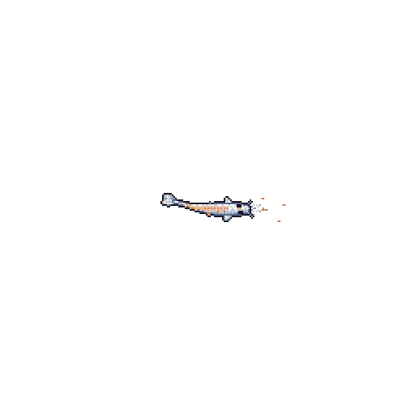

<table border="0">
  <tr>
    <!-- Columna Izquierda: Tu contenido -->
    <td valign="top" width="70%">
      <h1 align="center">¡Hola! Soy Noel Huereca</h1>
      <h3 align="center">Desarrollador Full-Stack · Laravel & Vue.js </h3>
      

        
        
        
      

    </td>
    <td valign="top" align="center" width="30%">
      <picture>
        <source media="(prefers-color-scheme: dark)" srcset="koi/koi.gif">
        <source media="(prefers-color-scheme: light)" srcset="koi/koi.gif">
        
      </picture>
    </td>
  </tr>
</table>

## 🧑‍💻 Sobre mí

Soy **Ingeniero en Sistemas** y desarrollador full-stack. Desde **junio de 2023** trabajo como **Ingeniero de Desarrollo en Grupo Energiko**, donde construyo y mantengo aplicaciones web internas para un grupo de empresas mexicanas.

- 🏢 Desarrollo sistemas **multiempresa** que comparten una sola base y se adaptan a la identidad de cada compañía.
- 📦 Trabajo en módulos de **pedidos de venta**, **facturación**, **recursos humanos** y **gestión de datos corporativos**.
- 🚀 Me encargo del ciclo completo: diseño de la base de datos, backend, interfaz y despliegue en **servidores Windows con IIS**.
- 🌱 Siempre estoy aprendiendo: hoy me interesan la arquitectura de aplicaciones Laravel, los sistemas de diseño y Linux.

---

## 🛠️ Stack principal

  
  
  
  
  
  
  

**Bases de datos e infraestructura**

  
  
  
  
  

---

## 💼 En qué trabajo

| Área | Descripción |
|------|-------------|
| 🏛️ **Portal corporativo** | Plataforma multiempresa con temas visuales por compañía. |
| 🧾 **Pedidos y facturación** | Flujos de venta desde la captura del pedido hasta la factura. |
| 👥 **Recursos humanos** | Módulos internos para la gestión de personal. |
| 🗂️ **Datos corporativos** | Centralización de la información de las empresas del grupo. |

---

## 📊 Estadísticas en GitHub

  
  

  

---

## 📫 Contacto

¿Tienes un proyecto o una oportunidad? Escríbeme por **[LinkedIn](https://www.linkedin.com/in/noel-huereca)**.

  

